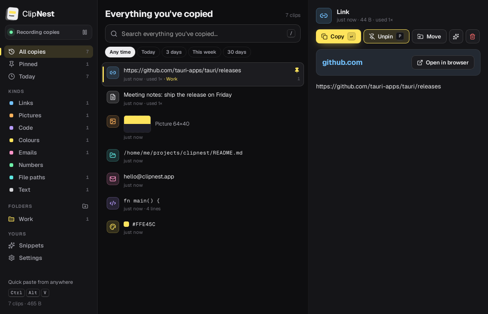
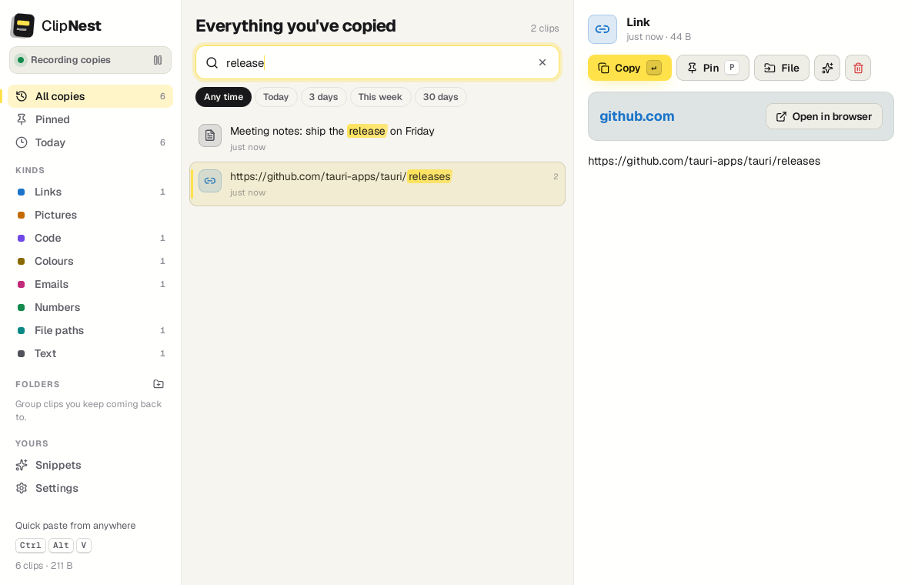
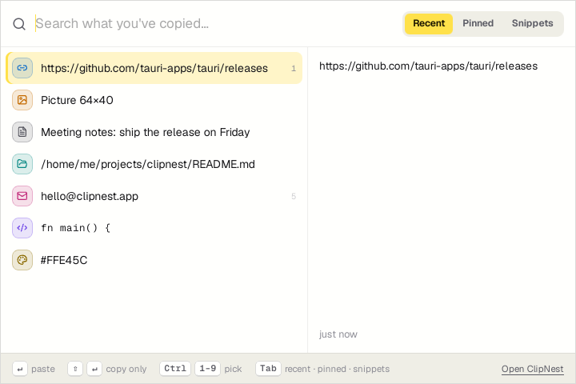
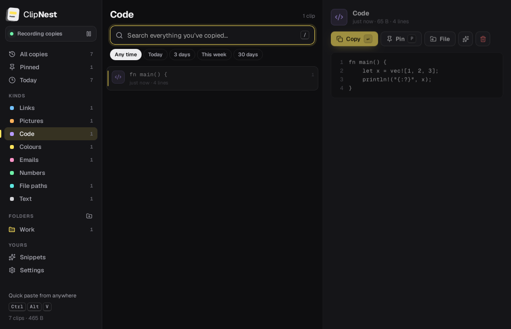
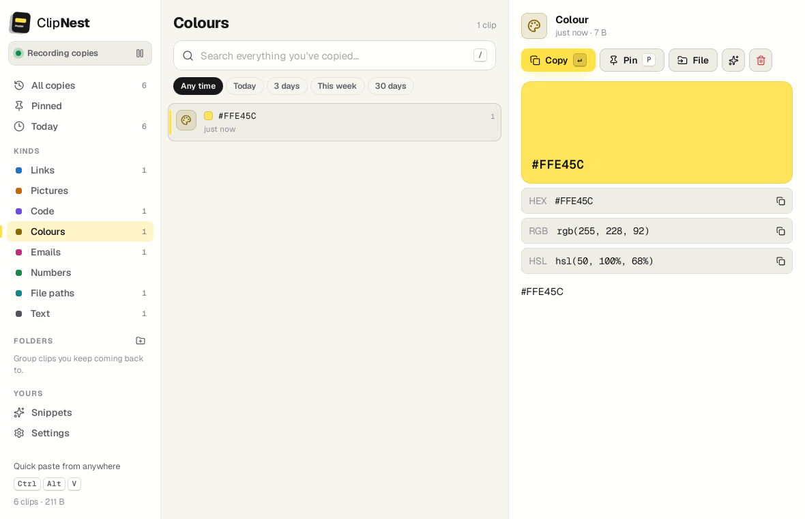
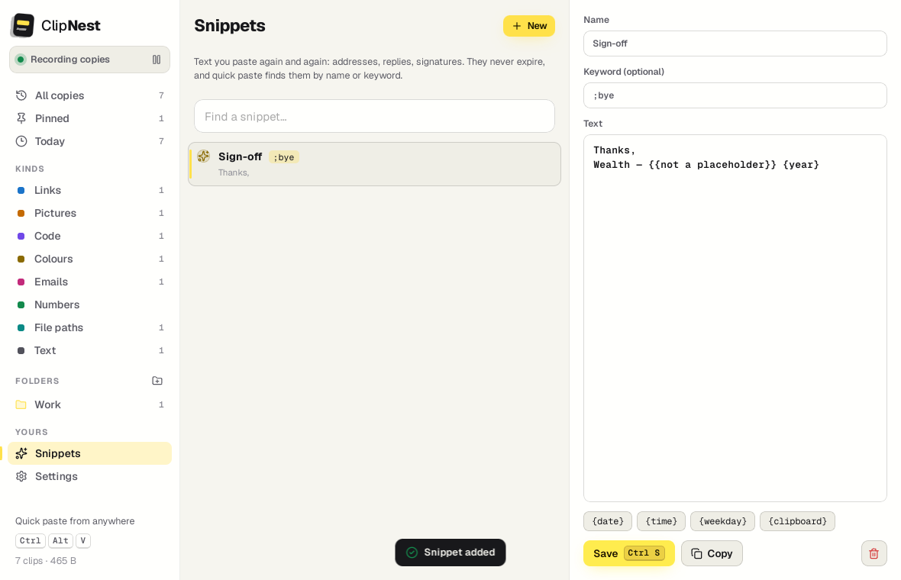
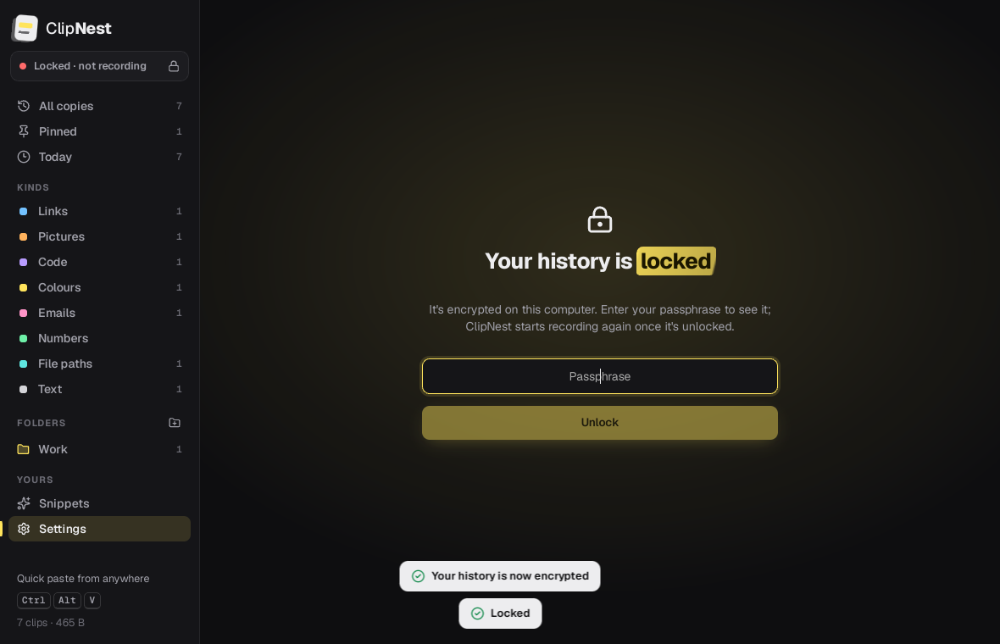

# ClipNest

**A clipboard manager that remembers everything you copy, so you can find it again.**

ClipNest runs in your tray and keeps every piece of text and every picture you copy. Press
<kbd>Ctrl</kbd> <kbd>Alt</kbd> <kbd>V</kbd> anywhere, type a few letters of something you copied last
Tuesday, press <kbd>Enter</kbd>, and it's pasted into the app you were in. Everything stays on your computer.

Built with **Tauri 2**, **Rust**, **SQLite (FTS5)**, **React 19** and **TypeScript**.



| Search with highlighted matches | Quick paste, from any app |
| --- | --- |
|  |  |
| **Code, with line numbers** | **Colours, in every format** |
|  |  |
| **Snippets with placeholders** | **Optional encryption** |
|  |  |

These screenshots come from the end-to-end test run against the real app (see [Tests](#tests)).

## Features

**Remembers what you copy**
- Text and pictures, newest first. Copy the same thing again and it moves to the top instead of being saved twice.
- Every clip is sorted into a kind, each with a colour and a preview that fits:
  - **Links** show the site and an *Open in browser* button.
  - **Colours** (`#FFE45C`, `rgb(…)`, `hsl(…)`) show a big swatch, and one click copies them as HEX, RGB or HSL.
  - **Code** is shown in a monospace font with line numbers.
  - **File paths** get a *Show in folder* button.
  - **Pictures** get a thumbnail in the list and a full preview.
  - Emails, numbers and plain text have their own kinds too.

**Finds it again: search what you copied in the last few days**
- Full-text search over the whole history (SQLite FTS5, prefix matching). Matches are swiped with a highlighter.
- Time filters: *Today*, *3 days*, *This week*, *30 days*. Typing `invoice` with *3 days* selected answers "what was that invoice number I copied the other day?"
- Filter by kind or folder from the sidebar.

**Keeps what matters**
- **Pin** a clip (<kbd>P</kbd>) to keep it forever and find it under *Pinned*.
- **Folders** group clips you keep coming back to. Clips in folders are never cleaned up either.
- **Snippets** are text you paste again and again: addresses, replies, signatures.
  - Give one a keyword (`;addr`). Typing that keyword exactly in quick paste puts the snippet first.
  - Placeholders are filled in when you paste: `{date}`, `{time}`, `{datetime}`, `{weekday}`, `{year}` and `{clipboard}` (whatever is on the clipboard right now). Write `{{` or `}}` for a literal brace.
  - Turn any clip into a snippet from its preview.

**Quick paste, from anywhere**
- The global shortcut (<kbd>Ctrl</kbd> <kbd>Alt</kbd> <kbd>V</kbd>, or <kbd>⌘</kbd> <kbd>⇧</kbd> <kbd>V</kbd> on macOS; change it in Settings) opens a small window on the screen your mouse is on.
- Type to search. <kbd>↑</kbd> <kbd>↓</kbd> choose, <kbd>Enter</kbd> pastes into the app you came from, <kbd>⇧</kbd> <kbd>Enter</kbd> only copies, <kbd>Ctrl</kbd> <kbd>1</kbd>–<kbd>9</kbd> picks directly, and <kbd>Tab</kbd> switches between Recent, Pinned and Snippets.

**Private by default**
- Nothing leaves your computer. No account, no sync, no network calls.
- **Passwords, keys and card numbers are spotted before they're saved.** This covers private keys, AWS, GitHub, Stripe, Slack and Google keys, `sk-…` API keys, JWTs and card numbers (Luhn-checked). By default they're not saved at all. You can choose to keep them masked instead; masked ones delete themselves after 15 minutes.
- **Password managers are ignored.** KeePass, KeePassXC, 1Password and Bitwarden are on the list from the start, and you can add any app. On Windows ClipNest also respects the flag password managers set to say "don't record this copy".
- **Pause** recording from the sidebar or the tray. Anything copied while paused is never saved, even after you resume.
- **Optional encryption.** Clips, pictures and snippets are encrypted on disk with a passphrase:
  - Argon2id derives a key that wraps a random data key; the data is sealed with XChaCha20-Poly1305.
  - ClipNest asks for the passphrase when it starts, and you can lock it any time from Settings. Nothing is recorded while it's locked.
  - Search keeps working while unlocked: it runs in memory and the decrypted text is never written to disk.
  - There is no way to recover a forgotten passphrase.

**Tidy without thinking about it**
- Keeps copies for 30 days and at most 5,000 by default. You can change both. Pinned clips and clips in folders are kept forever.
- Pictures over 20 MB are skipped (you can change the limit, or turn picture capture off).
- Export the whole history to JSON. Clear history while keeping pinned clips and folders.

**Fits in**
- Tray icon with a menu: your latest clips (click one to copy it), quick paste, pause, open and quit.
- Start with your computer, start hidden, light and dark themes (or match the system).
- Only one copy of ClipNest runs at a time; starting it again just opens the window.

## Keyboard

| Where | Keys | Does |
| --- | --- | --- |
| Anywhere | <kbd>Ctrl</kbd> <kbd>Alt</kbd> <kbd>V</kbd> (<kbd>⌘</kbd> <kbd>⇧</kbd> <kbd>V</kbd>) | Open quick paste |
| History | <kbd>/</kbd> or <kbd>Ctrl</kbd> <kbd>F</kbd> | Search |
| History | <kbd>↑</kbd> <kbd>↓</kbd> | Move through clips |
| History | <kbd>Enter</kbd> | Copy the selected clip |
| History | <kbd>Ctrl</kbd> <kbd>1</kbd>–<kbd>9</kbd> | Copy the first nine clips |
| History | <kbd>P</kbd> | Pin or unpin |
| History | <kbd>Delete</kbd> | Delete |
| History | <kbd>Esc</kbd> | Clear the search |
| Snippets | <kbd>Ctrl</kbd> <kbd>S</kbd> | Save the snippet |
| Quick paste | <kbd>Enter</kbd> / <kbd>⇧</kbd> <kbd>Enter</kbd> | Paste / only copy |
| Quick paste | <kbd>Tab</kbd> | Recent → Pinned → Snippets |
| Quick paste | <kbd>Esc</kbd> | Clear, then close |

## Install

Download an installer from [Releases](../../releases). Tagged builds are made by CI for Windows (`.msi`, `.exe`), macOS (`.dmg`) and Linux (`.deb`, `.AppImage`, `.rpm`).

- **macOS:** to paste straight into other apps, ClipNest needs *System Settings → Privacy & Security → Accessibility*. Without it, quick paste copies and you press <kbd>⌘</kbd> <kbd>V</kbd> yourself.
- **Linux:** clipboard and paste work on X11, and on Wayland with compositors that support the data-control protocol (wlroots-based ones, KDE). Auto-paste uses `xdotool`, which the `.deb` installs.

## Build it yourself

You need Node 22+, Rust (stable), and on Linux the WebKitGTK headers:

```bash
# Debian/Ubuntu only
sudo apt install libwebkit2gtk-4.1-dev libayatana-appindicator3-dev librsvg2-dev libxdo-dev patchelf

npm install
npm run dev        # run the app with hot reload
npm run build      # installers into src-tauri/target/release/bundle/
```

## Tests

```bash
npm run typecheck && npm run lint
npm test                 # TypeScript unit tests (search highlighting, colours, shortcuts…)
npm run test:rust        # Rust: store, search, snippets, secrets, vault, classification

# End-to-end, against the real app binary (Linux)
sudo apt install webkit2gtk-driver xclip xvfb
cargo install tauri-driver --locked
npx tauri build --debug --no-bundle
xvfb-run -a -s "-screen 0 1600x1000x24" npm run test:e2e
```

The end-to-end suite (`e2e/run.mjs`) starts the real app through `tauri-driver`. It copies things with `xclip`, so the Rust clipboard watcher sees real copies, and checks the results in the UI. It covers:
- recording and classifying copies, de-duplication, and skipping card numbers
- search and highlighting
- colour and code previews
- copying back to the clipboard without re-recording
- pins and folders
- picture capture
- snippets with placeholders
- the quick paste window
- themes and pausing
- turning encryption on, locking, a wrong and a right passphrase, and encrypted search
- a restart

It writes screenshots to `e2e/shots/`. It needs no test framework, only Node's `fetch` speaking WebDriver.

CI (`.github/workflows/ci.yml`) runs the TypeScript checks, `cargo clippy` and `cargo test` on Windows, macOS and Linux, and the end-to-end suite on Linux. When you push a `v*` tag it builds draft-release installers for all three.

> **Windows note:** the Windows-specific code is the clipboard change counter, the source app lookup and the "don't record" flag, in `src-tauri/src/platform.rs`. It was type-checked on Linux with `RUSTFLAGS="--cfg clipnest_check_win" cargo check`, but it is first compiled and tested for real by the Windows CI job.

## How it works

```
┌──────────── Rust (src-tauri/src) ────────────┐      ┌──────── React (src) ────────┐
│ lib.rs       watcher thread polls clipboard  │      │ views/Main.tsx  history     │
│              (change counter on Windows),    │ ───► │ views/Quick.tsx quick paste │
│              tray, global shortcut, paste    │ IPC  │ views/Preview.tsx previews  │
│ store.rs     SQLite + FTS5, folders, prune,  │ ◄─── │ views/Settings.tsx          │
│              snippets & placeholders         │      │ api.ts  typed invoke calls  │
│ classify.rs  link/code/colour… and secrets   │      └─────────────────────────────┘
│ vault.rs     Argon2id + XChaCha20-Poly1305   │
│ platform.rs  Windows/macOS/Linux differences │
└──────────────────────────────────────────────┘
```

- **Storage** is one SQLite file: `clipnest.db` in the app data folder, or `CLIPNEST_DATA_DIR` if that's set. Pictures are stored as PNG files in an `images` folder beside it, each with a small thumbnail.
- **Search** uses an FTS5 table that triggers keep in sync. With encryption on, the FTS table is empty and search runs over the text decrypted in memory.
- **Your own copies:** when ClipNest puts something on the clipboard, it notes that content's fingerprint, so the watcher doesn't record it as a new copy.
- **Pasting into the previous app:** quick paste hides itself, focus goes back to the app you were in, and ClipNest sends <kbd>Ctrl</kbd>/<kbd>⌘</kbd> <kbd>V</kbd>.

## License

MIT © Wealth Hajoh
